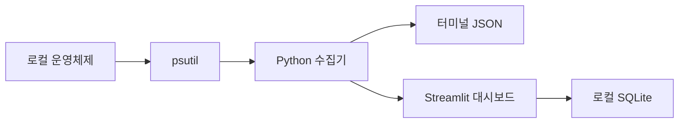

# PC Condition

Python과 psutil로 로컬 PC의 자원 사용량을 수집하고, Streamlit으로 표시하는 모니터링 도구입니다. 실시간 측정과 SQLite 기록 조회를 지원합니다. 왼쪽 성능 메뉴에서 전체 보기 또는 CPU·RAM·GPU·네트워크·디스크를 선택하면 상세 화면을 확인할 수 있습니다.

## Windows에서 더블클릭 실행

Python 3.10 이상이 설치된 Windows에서 ZIP 전체를 압축 해제하고 `Start-PC-Condition.cmd`를 더블클릭합니다. 첫 실행 시 가상환경과 필요한 패키지를 준비하며 인터넷 연결이 필요합니다. 기존 `.venv` 또는 `syswatch/.venv`가 있으면 사용합니다.

대시보드는 브라우저에서 열립니다. 실행 중에는 명령창을 열어 두고, 종료할 때 Ctrl+C를 누릅니다. 기존 설치 폴더에 새 ZIP의 파일을 덮어쓰고 다시 실행하면 업데이트된 버전을 사용할 수 있습니다.

이 시작 스크립트는 Linux 환경에서 파일 구성과 경로 처리를 검토했습니다. Windows에서 실제 더블클릭 실행 검증은 남아 있습니다.

## 설치 및 실행

Python 3.10 이상이 설치된 환경에서 프로젝트 폴더를 열고 가상환경을 만듭니다.

```shell
python -m venv .venv
```

Windows PowerShell에서는 `.\.venv\Scripts\Activate.ps1`, Linux에서는 `source .venv/bin/activate`를 실행합니다. Linux에서 `python` 명령이 없는 경우 가상환경 생성에 `python3`를 사용합니다.

```shell
python -m pip install -r requirements.txt
python -m syswatch
python -m streamlit run dashboard.py --server.address 127.0.0.1
```

브라우저에서 [로컬 대시보드](http://127.0.0.1:8501)를 엽니다. 터미널 명령은 1초 동안 측정한 결과를 JSON으로 출력합니다. 대시보드는 기본값으로 1초마다 측정하며, 실시간 그래프는 세션의 최근 10분을 표시합니다. **갱신 주기**에서 높음(약 0.5초), 보통(1초), 낮음(약 4초), 일시 중지를 선택할 수 있습니다. 일시 중지 중 F5를 누르면 한 번 측정한 뒤 자동 갱신이 중지된 상태로 유지됩니다.

## 데이터 흐름



CPU 사용률은 두 샘플 사이의 전체 CPU 시간과 유휴 시간 차이로 계산합니다. RAM 사용량은 전체에서 사용 가능한 메모리를 뺀 값입니다. 네트워크 속도는 누적 바이트 차이를 실제 측정 간격으로 나눈 값입니다. 디스크는 psutil이 보고하는 접근 가능한 마운트 지점별로 표시합니다.

## 확인 방법

- Windows 작업 관리자나 Linux의 `top`, `free`, `df -h`와 비슷한 시점의 값을 비교합니다. 갱신 간격과 단위 표기에 따라 값이 달라질 수 있습니다.
- 대시보드를 열어 측정 시각이 갱신되고 그래프에 샘플이 추가되는지 확인합니다.
- 파일 다운로드 중 수신 속도와 누적 수신량이 늘어나는지 확인합니다.

## 측정 기록

대시보드를 열어 두면 CPU·RAM·GPU 사용률과 네트워크 속도가 프로젝트 폴더의 `data/measurements.sqlite3`에 저장됩니다. 선택한 주기에 따라 측정하며, 여러 탭이 열려 있어도 같은 0.5초 구간에는 최대 한 건을 저장합니다. 저장 시 7일보다 오래된 구간은 정리합니다.

**기록** 탭에서 최근 15분, 1시간, 24시간을 조회할 수 있습니다. 1시간 그래프는 10초 평균, 24시간 그래프는 1분 평균을 표시합니다. 대시보드를 재시작해도 기록이 유지됩니다. 기록 파일은 Git 추적에서 제외됩니다.

## 다음 단계

경고, 설정, CSV 내보내기는 기획서의 2차 단계에 남아 있습니다. SSH를 통한 Linux 서버 모니터링과 재연결 처리는 3차 단계입니다.

## GPU 사용률

Windows에서 PDH의 GPU Engine 성능 카운터로 GPU 사용률을 측정합니다. 프로세스별 수치를 같은 GPU 엔진끼리 합산하고, 여러 GPU와 엔진 중 가장 높은 사용률을 대표값으로 표시합니다. 드라이버가 해당 카운터를 제공해야 하며, 측정 간격과 집계 방식에 따라 작업 관리자 수치와 차이가 날 수 있습니다.

실시간 수치와 그래프, SQLite 기록과 과거 그래프에 GPU 사용률이 포함됩니다. 기존 데이터베이스는 실행 시 GPU 열이 추가되며, 이전 기록의 GPU 값은 비어 있습니다. Linux 및 GPU 정보를 읽을 수 없는 환경에서는 수치를 `—`로 표시하고 안내 문구를 제공합니다.

Windows GPU의 실제 측정은 Windows PC에서 작업 관리자의 성능 탭과 비교해 확인해야 합니다.
