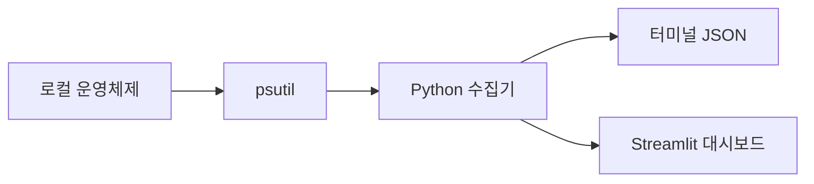

# SysWatch

Python과 psutil로 로컬 PC의 자원 사용량을 수집하고, Streamlit으로 표시하는 모니터링 도구입니다. 현재 범위는 기획서의 1차 MVP입니다.

## 설치 및 실행

Python 3.10 이상이 설치된 환경에서 프로젝트 폴더를 열고 가상환경을 만듭니다.

```shell
python -m venv .venv
```

Windows PowerShell에서는 `.\.venv\Scripts\Activate.ps1`, Linux에서는 `source .venv/bin/activate`를 실행합니다. Linux에서 `python` 명령이 없는 경우 가상환경 생성에 `python3`를 사용합니다.

```shell
python -m pip install -r requirements.txt
python -m syswatch
python -m streamlit run dashboard.py --server.address 127.0.0.1
```

브라우저에서 [로컬 대시보드](http://127.0.0.1:8501)를 엽니다. 터미널 명령은 1초 동안 측정한 결과를 JSON으로 출력합니다. 대시보드는 열린 상태에서 약 2초마다 새로 측정하고 브라우저 세션별로 최근 300개 샘플을 유지합니다.

## 데이터 흐름



CPU 사용률은 두 샘플 사이의 전체 CPU 시간과 유휴 시간 차이로 계산합니다. RAM 사용량은 전체에서 사용 가능한 메모리를 뺀 값입니다. 네트워크 속도는 누적 바이트 차이를 실제 측정 간격으로 나눈 값입니다. 디스크는 psutil이 보고하는 접근 가능한 마운트 지점별로 표시합니다.

## 확인 방법

- Windows 작업 관리자나 Linux의 `top`, `free`, `df -h`와 비슷한 시점의 값을 비교합니다. 갱신 간격과 단위 표기에 따라 값이 달라질 수 있습니다.
- 대시보드를 열어 측정 시각이 갱신되고 그래프에 샘플이 추가되는지 확인합니다.
- 파일 다운로드 중 수신 속도와 누적 수신량이 늘어나는지 확인합니다.

## 다음 단계

SQLite 기록과 조회, 경고, 설정, CSV 내보내기는 기획서의 2차 단계입니다. SSH를 통한 Linux 서버 모니터링과 재연결 처리는 3차 단계입니다.
